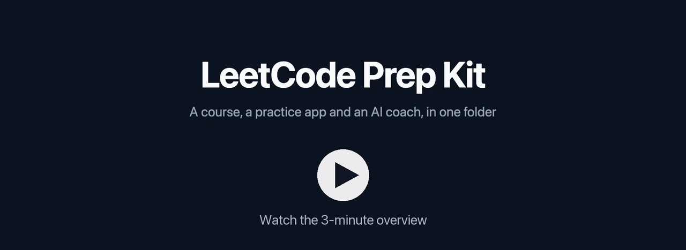

# LeetCode Prep Kit

**A coding-interview course in Python, a practice app and an AI coach, all in one folder.**

You work through the course in a local web app. An AI coach (Claude Code or OpenAI Codex, running on your own account) sets up your plan, marks your answers, reviews your code and keeps your notes. It won't write your solutions unless you ask for one.

<p align="center">
  <a href="docs/overview.mp4">
    
  </a>
  <br>
  <a href="docs/overview.mp4"><b>▶ Watch the 3-minute overview</b></a>
</p>

If you already have the folder, the same video is at `docs/overview.mp4`.

---

## 1. What's inside

| Part | What it is |
|---|---|
| **The course** | Eleven modules, from Big-O up to dynamic programming and heaps. There's also a timed diagnostic and three reference sheets (Python toolkit, decision rules, bug checklist) |
| **The app** | Runs in your browser, on your machine. It shows your lessons and your progress and has a code editor. You can solve 119 problems in it and run them on its tests |
| **The coach** | Claude Code or OpenAI Codex, connected to the app. It plans your weeks, gives hints, reviews your code and updates your skills matrix |

## 2. Quick start

```bash
git clone https://github.com/idrisalami/leetcode-prep-kit.git
cd leetcode-prep-kit
python3 app/server.py
```

You can also download the folder as a ZIP: on GitHub, click **Code → Download ZIP**, unzip it, and run the last line inside it.

The command opens the app in your browser. Then:

1. **The welcome page** looks for a coach tool on your computer and connects the one you pick. You can also go on without a coach for now.
2. **The Home page** lists your first five steps (section 4). It ticks each one off as you finish it.
3. **To stop the app**, press `Ctrl+C` in the terminal. To come back later, run `python3 app/server.py` again, and you pick up where you stopped.

## 3. What you need

| Need | Details |
|---|---|
| **macOS or Linux** | On Windows, run it inside [WSL](https://learn.microsoft.com/windows/wsl/install) |
| **Python 3.9 or later** | The app uses only the standard library, so there is nothing to install |
| **A coach tool, installed and signed in** | [Claude Code](https://claude.com/claude-code) (recommended; the kit was written for it) or [OpenAI Codex](https://github.com/openai/codex). The lessons, the editor and the tests work without one |
| **A LeetCode account** | For the drills that link to LeetCode. Premium is optional: each 🔒 row in a drill table says what to do if a problem is locked, and the 🔒 problems in the app can be solved there without Premium |

## 4. Your first five steps

The Home page walks you through these.

| Step | Where you do it | Needs the coach? |
|---|---|---|
| **1. Download the problem statements** | A button on the Home page | No |
| **2. Set up your plan** | A chat in the app: your target, your timeline, your hours per week | Yes |
| **3. Answer module 00's self-check** | A page in the app; the coach marks it | Yes |
| **4. Take the diagnostic** | A timed page with no Run button. The app runs your answers on its tests and the coach scores them | Yes |
| **5. Solve your first problem** | The editor in the app | No, but with a coach you get a review |

## 5. How the course works

| Stage | What happens |
|---|---|
| **1. Discovery** | A short talk about your target, timeline, experience and goals. It sets your pace and your priorities |
| **2. Module 00 self-check** | Short questions on the basics. You read the sections behind any you miss |
| **3. Diagnostic** | Seven timed problems, written without running the code, about 2h50 in one sitting ([course/diagnostic.md](course/diagnostic.md)) |
| **4. Scoring and plan** | Your answers are scored, your skills matrix is filled in and your plan gets dates |
| **5. Modules 01–10** | For each module: read its §0, answer its self-check, solve its drills cold, then the coach reviews your code by running it and you write a lesson. See [course/README.md](course/README.md) |

## 6. Talking to the coach outside the app

The app and the terminal share the same notes, so you can switch between them at any time.

- **Claude Code:** open a terminal in this folder, run `claude`, and say *"let's start"*. It reads [CLAUDE.md](CLAUDE.md) and picks up where you stopped.
- **OpenAI Codex:** do the same with `codex`. [AGENTS.md](AGENTS.md) points it at the same coaching rules.

To change the coach later, use the **Coach** line in the app's menu.

## 7. What's in the folder

```
leetcode-prep-kit/
├── app/            the practice app (python3 app/server.py)
├── course/         the same for everyone
│   ├── modules/    00 Before you start → 10 Heaps
│   ├── reference/  Python toolkit, decision rules, bug checklist
│   ├── templates/  blank copies of your notes files
│   └── diagnostic.md
├── docs/           the overview video
├── CLAUDE.md       coaching rules for Claude Code
└── AGENTS.md       the same rules for OpenAI Codex
```

**`my-prep/`** shows up the first time you start the app (or at your first session with the coach). Everything about you goes there: your plan, your skills matrix, your lessons, your solutions. Git ignores it, so your progress stays on your machine and never ends up in a commit.

## 8. The app in detail

| Page | What it does |
|---|---|
| **Home** | A daily warm-up, your totals and your progress per module |
| **Skills matrix** | Your skill levels, with filters and links to your notes. The lessons are under the module links in the menu |
| **Practice** | The problem on the left, the editor in the middle, the coach on the right |

- **Options:** `python3 app/server.py --port 9000` picks a port; `--no-open` skips opening the browser tab. By default the app uses port 8765, or the next free port up to 8775.
- **Statements from the command line:** `python3 app/setup.py` does the same as the Download button. The text is saved to `app/data/statements/`, which git ignores.
- **Drills outside the app:** the course's other drills link to LeetCode.

<details>
<summary><b>What the app stores, and where</b></summary>

- Your code: `my-prep/solutions/<slug>.py`. Extra solution tabs are separate files next to it.
- Earlier versions (every submit, plus the code from before a Reset, a Redo or a closed tab): `my-prep/solutions/history/`. Delete those files by hand if you want them gone.
- App state: `my-prep/app/state.json` (don't edit it by hand). The coach you picked: `my-prep/app/settings.json`.
- It appends to `my-prep/learnings.md` and to the log table in `my-prep/bugs.md`.
- In `my-prep/skills-matrix.md` it updates the Now, Evidence and Last tested columns, and fills Start the first time, while that cell is `?`. It never lowers a level it didn't set itself. In the Evidence cell it owns only the part that ends in `(app)` and keeps any other text in place.
- If `my-prep/` is missing, it is created again from `course/templates/`.

</details>

## 9. Privacy

- The app listens only on `127.0.0.1`, so nobody else on your network can reach it.
- Downloading the statements sends nothing personal and uses no cookies.
- Coach replies go through your own Claude Code or Codex account and count against your usage there. Nothing else leaves your machine.

## 10. Known limits

<details>
<summary><b>Read these before you rely on the app</b></summary>

- Passing the app's tests doesn't mean LeetCode will accept the solution. The tests are the kit's, not LeetCode's.
- Your code runs on your machine with your permissions. It has a time limit but no sandbox, and the time limit is the only guard: a solution that keeps allocating memory can slow your machine until it stops.
- If your code starts a child process of its own, that process can keep running after the time limit stops your code.
- With OpenAI Codex, a coach reply appears all at once when it's finished. With Claude Code, you see it as it's written.
- `my-prep/` must be a real folder, not a symlink, or the app refuses to start.
- Start the app once. A second start finds the first one and opens it, but two starts at the same moment can both run, and then whichever saves last wins. If that happens, stop both and start one.
- Several runs can go at once, for example from two tabs.
- The scratch tab and the "coach hidden" choice are stored in your browser for each address, so they don't carry over to another port or another browser.

</details>

## 11. Licence

MIT. See [LICENSE](LICENSE).
